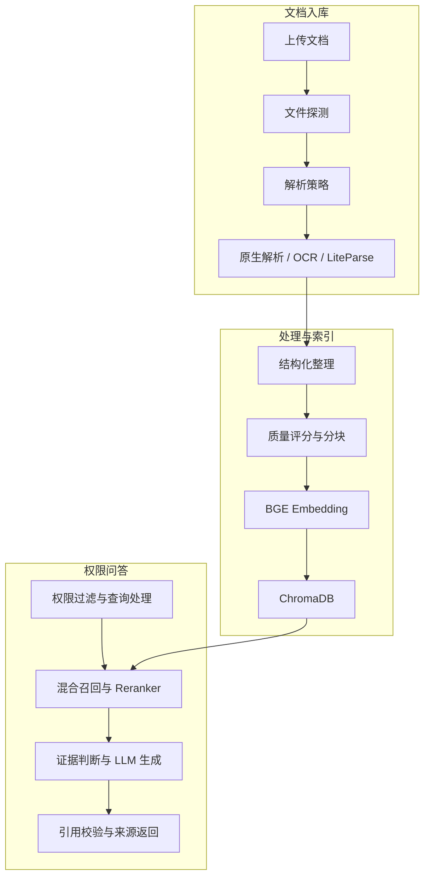

# RAG Agent KB System

面向企业内部知识管理场景的多用户 RAG 知识库系统。系统覆盖文档上传、格式识别、解析与 OCR、质量评估、向量化入库、权限过滤检索、证据约束生成、引用校验和操作审计。

项目采用轻量 Ingestion Agent 调度不同文档处理策略，并使用受控的 RAG 问答链路，在保证可追溯性的同时控制推理延迟和 API 成本。

## 核心能力

- **多格式文档入库**：支持 PDF、TXT、Markdown、DOC(X)、PPT(X) 和 XLS(X)。
- **复杂文档解析**：结合 PyMuPDF、PaddleOCR、LiteParse 和 LibreOffice，处理扫描件、表格、图片型页面及旧版 Office 文档。
- **智能处理策略**：通过 `FileProbe → StrategyPlanner → Parse/OCR → Normalize → ChunkQuality → Index → Report` 完成入库调度和阶段追踪。
- **结构化切块**：统一使用 `DocumentBlock` 中间结构，保留页码、标题路径、幻灯片、工作表、单元格范围和表号等来源信息。
- **混合检索**：融合 BGE Embedding、BM25、关键词匹配和 BGE Reranker，兼顾语义查询与标准号、术语、数值类精确查询。
- **可靠回答**：支持查询归一化、同义词扩展、复杂问题按需分解、证据充分性判断和答案内嵌 `[n]` 引用。
- **权限控制**：支持管理员、普通用户、部门、单文档权限和文档集批量授权，权限同时作用于接口访问与检索范围。
- **可观测性**：记录文档处理任务、质量报告、问答日志、检索 Trace 和权限变更审计日志。

## 系统流程



证据不足时，系统返回“未找到”，不会使用模型常识补全知识库中不存在的结论。

## 技术栈

| 层级 | 技术 |
| --- | --- |
| 前端 | Vue 3、Vite、TypeScript、Element Plus |
| 后端 | FastAPI、SQLAlchemy、Pydantic、JWT |
| 业务数据 | SQLite，可迁移 PostgreSQL |
| 向量数据库 | ChromaDB |
| 检索模型 | BGE-M3、BGE Reranker v2-m3 |
| 文档处理 | PyMuPDF、pypdf、PaddleOCR、LiteParse、LibreOffice |
| 大模型 | OpenAI-compatible API，默认适配 DeepSeek |

## 项目结构

```text
rag-agent-kb-system/
├── backend/
│   ├── app/
│   │   ├── agent/       # 入库策略与节点编排
│   │   ├── api/         # FastAPI 路由
│   │   ├── core/        # 配置、安全与日志
│   │   ├── db/          # 数据库会话与初始化
│   │   ├── models/      # SQLAlchemy 模型
│   │   ├── rag/         # 解析、切块、Embedding、检索、OCR
│   │   ├── schemas/     # Pydantic 数据模型
│   │   └── services/    # 业务服务
│   ├── scripts/         # 评测与维护脚本
│   └── tests/
├── frontend/
│   └── src/
├── data/
│   ├── uploads/
│   ├── chroma/
│   ├── models/
│   ├── logs/
│   └── eval/
└── docs/
```

## 快速启动

### 1. 后端环境

推荐使用 Python 3.10 或 3.11：

```powershell
conda create -n rag-agent python=3.11
conda activate rag-agent

cd backend
pip install -r requirements.txt
pip install -r requirements-rag.txt
```

需要处理扫描 PDF 时，再安装 OCR 依赖：

```powershell
pip install -r requirements-ocr.txt
```

旧版 `.doc`、`.ppt`、`.xls` 文件需要本机安装 LibreOffice，并确保其命令可被系统调用。

### 2. 环境配置

```powershell
cd backend
Copy-Item .env.example .env
```

至少需要检查以下配置：

```env
SECRET_KEY=replace-with-a-long-random-secret

FIRST_SUPERUSER_USERNAME=admin
FIRST_SUPERUSER_PASSWORD=replace-with-a-strong-password

OPENAI_API_KEY=your_api_key
OPENAI_BASE_URL=https://api.deepseek.com
OPENAI_MODEL=deepseek-chat

EMBEDDING_MODEL_NAME=../data/models/embeddings/bge-m3
RERANKER_MODEL_NAME=../data/models/rerankers/bge-reranker-v2-m3
```

真实 `.env`、模型权重、上传文件、业务数据库和 ChromaDB 数据均已在 `.gitignore` 中排除。

### 3. 启动后端

```powershell
cd backend
uvicorn app.main:app --reload
```

- 健康检查：<http://127.0.0.1:8000/health>
- API 文档：<http://127.0.0.1:8000/docs>

首次启动会初始化 SQLite 表，并根据 `.env` 创建初始管理员。

### 4. 启动前端

```powershell
cd frontend
npm install
npm run dev
```

前端默认地址：<http://127.0.0.1:5173>

## 模型目录

本地模型建议放置在：

```text
data/models/
├── embeddings/bge-m3/
├── rerankers/bge-reranker-v2-m3/
└── ocr/paddleocr/
```

模型配置与下载说明见 [docs/MODEL_ASSETS.md](docs/MODEL_ASSETS.md)。

## 测试

后端单元测试：

```powershell
cd backend
python -m pytest -q
```

前端类型检查与生产构建：

```powershell
cd frontend
npm run build
```

RAG v2 测试集包含 500 条领域问题。最近一次基于清洗后测试集的离线重判结果为：

```text
452 / 500 = 90.40%
```

完整评测会调用 LLM API：

```powershell
cd backend
python scripts/run_rag_eval.py `
  --username admin `
  --testset ../data/eval/rag_testset_v2.json `
  --output ../data/eval/results/rag_eval_v2_latest.json
```

## 设计说明

- [DocumentBlock 统一中间结构](docs/DOCUMENT_BLOCK.md)
- [Ingestion Agent 设计](docs/INGESTION_AGENT_DESIGN.md)
- [PDF 预处理策略](docs/PDF_PREPROCESSING.md)
- [OCR、切块质量与 LLM 归一化](docs/OCR_CHUNK_QUALITY_LLM.md)
- [BM25 混合检索](docs/BM25_HYBRID_RETRIEVAL.md)
- [用户组、文档集权限与审计](docs/PERMISSION_AUDIT.md)
- [模型文件说明](docs/MODEL_ASSETS.md)

## 当前限制

- 文档处理任务使用 FastAPI `BackgroundTasks` 和本地并发控制，尚未接入独立任务队列。
- 业务数据库默认为 SQLite，生产部署建议迁移 PostgreSQL。
- GPU OCR、Embedding 和 Reranker 需要根据目标显卡与 CUDA 环境单独安装匹配依赖。
- ChromaDB 保存向量与检索元数据，后续可增加独立的 chunk 业务表和持久化倒排索引。
