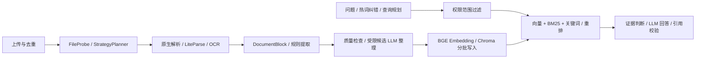

# RAG Agent KB System

面向企业知识管理和食品安全标准问答的多用户 RAG 知识库。覆盖文档上传、格式探测、解析与 OCR、结构化切块、权限过滤、混合检索、证据约束回答和引用追踪。

本版更新：**2026-10-10**，完整变更见 [CHANGELOG.md](CHANGELOG.md)。

## 当前能力

- **多格式入库**：PDF、DOC/DOCX、PPT/PPTX、XLS/XLSX、Markdown、TXT；按文件探测结果选择原生解析、LiteParse 或 PaddleOCR，保留页码、表格、标题路径、幻灯片与单元格位置。
- **递归文件夹导入**：预览、勾选、搜索和分页；过滤 `.DS_Store`、`__MACOSX`、隐藏文件、临时文件、空文件及超限文件；站内切页继续提交后续文件。
- **精确去重**：同一上传者、同一文档集内，按大小与 SHA-256 识别相同字节；复用已有文档，跳过解析、LLM 和向量入库。
- **文档与权限管理**：独立侧栏入口、文档列表组合筛选与分页、文档集、用户/部门授权及审计；检索取当前账号有权访问的已入库文档交集。
- **LLM 整理预算**：默认关闭前置逐行事实整理，保留规则提取及候选整理；单文档默认最多 120 次请求、600 秒预算、每项最多 1 次显式重试。达到约束时保留原文与已有结果。
- **真实处理状态**：展示阶段、已处理/总数、请求、重试与跳过原因；分别显示 LLM 检测和整理结果，不把开关开启当作处理成功。
- **混合检索与参数偏好**：BGE-M3、BM25、关键词及 BGE Reranker；问答侧栏支持快速、均衡、深入、自定义，按账号保存本浏览器偏好。
- **食品术语辅助**：48 个基础热词，覆盖添加剂、污染物、微生物和检测指标。配置的错字自动修正，近似词由用户采纳；本地预检显示检索问题，不额外调用 LLM。
- **结论与依据**：引用并入依据，支持原文位置、检索 Trace 和纠错记录；证据判断未通过时返回未找到或检索证据模式。

## 系统流程



入库 Agent 是受控节点流程。LLM 策略规划和问答规划可选，本地启动器默认关闭额外规划调用。`chat` 模式下，模型先根据问题决定是否查询知识库；决定查询后仍走现有规划、混合检索和证据判断。`offline` 保持每次检索。

## 技术栈

| 层级 | 实现 |
| --- | --- |
| 前端 | Vue 3、Vite、TypeScript、Element Plus |
| 后端 | FastAPI、SQLAlchemy、Pydantic、JWT |
| 数据 | SQLite、ChromaDB |
| 检索 | BGE-M3、BGE Reranker v2-m3、BM25、关键词 |
| 解析 | PyMuPDF、pypdf、PaddleOCR、LiteParse、LibreOffice |
| LLM | OpenAI-compatible API，可配置 DeepSeek 等服务 |

## Windows 快速启动

准备 Python 和 Node.js/npm。完整本地 RAG/OCR 组合已在 **Windows + Python 3.12** 验证；GPU 组合使用 PyTorch 2.7.1 + CUDA 12.8。

```powershell
git clone https://github.com/Redamancy39/rag-agent.git
cd rag-agent
.\START_LOCAL.bat
```

启动器复用或创建根目录 `.venv`，检查基础后端和前端依赖；缺少配置时生成本地 `.env`，使用随机 JWT 密钥，并留空 API Key 和管理员密码。已有环境和配置保留。**基础启动保证页面与账号/API 可用；完整入库还需要准备 RAG 依赖和模型。**

- 页面：<http://127.0.0.1:5173>
- API：<http://127.0.0.1:8000/docs>
- 停止：`.\STOP_LOCAL.bat`，关闭启动窗口不会停止服务。
- 检查：`.\START_LOCAL.bat -Action check`
- 不打开浏览器：`.\START_LOCAL.bat -NoBrowser`

首次可注册普通账号。管理员需要自行设置 `backend/.env` 的 `FIRST_SUPERUSER_USERNAME`、`FIRST_SUPERUSER_PASSWORD`；已有账号不会因重启重建或重置。启动器校验 PID、创建时间与命令，其他程序占用端口时明确失败，不结束无关进程。详情见 [本地启动](docs/LOCAL_START.md)。

## 完整入库与生成式问答

| 文件 | 用途 | 说明 |
| --- | --- | --- |
| `backend/.env` | JWT、数据库、API Key、地址与模型 | [后端配置](backend/README.md) |
| `backend/.env.rag` | BGE-M3 与重排 | [本地检索](docs/LOCAL_RAG.md) |
| `backend/.env.ocr` | CPU PaddleOCR | [本地 OCR](docs/LOCAL_OCR.md) |
| `backend/.env.llm` | `offline` / `chat` / `chat_and_normalization` | [LLM 模式和预算](docs/LOCAL_LLM.md) |

没有 `.env.llm` 时，本地启动器默认不调用外部 LLM。模型须显式下载、校验和配置，日常启动复用本地文件。旧版 Office 需要 LibreOffice，LiteParse 需单独安装并提供 `lit` 命令。文件夹需先解压，不自动处理 ZIP/RAR/7z。

真实配置、模型权重、数据库、上传文件、运行日志与本机排查报告不随仓库发布。手动运行方式见 [backend/README.md](backend/README.md) 和 [frontend/README.md](frontend/README.md)。

## 问答参数

| 参数 | 范围与默认行为 |
| --- | --- |
| Top-K | 5–40，默认 5 |
| 候选数 | 自动 `max(32, 2 × Top-K)`；手动 16–128，不小于 Top-K |
| 证据上下文 | 自动 `max(16000, 1200 × Top-K)` 字符；手动 8000–64000 |
| 重排 | 每次提问独立选择，结果记录实际是否执行 |
| 偏好与任务 | 按账号保存在本浏览器，发送时冻结到任务 |

快速与均衡的 Top-K 均为 5，候选数分别为 16 和 32；深入为 Top-K 20、候选 40。上下文按完整块选取，超预算块跳过后继续尝试其他块。输入预算至少预留配置窗口的 30% 用于输出；窗口与输出上限须匹配实际服务能力。当前使用 UTF-8 字节上界估算，不声称精确 token 计数，模型实际 usage 单独记录。

## 测试与评测

```powershell
# 仓库根目录
$env:PYTHONPATH = (Join-Path (Get-Location) 'backend')
.\.venv\Scripts\python.exe -m unittest discover -s backend/tests -q
cd frontend
npm test
npm run build
```

本版验证：后端 **122 项**、前端 **15 项**测试通过，类型检查与生产构建通过；合成 UI 覆盖文件夹导入、列表筛选、参数和纠错。构建仍有大 bundle 提示。本版未运行新的付费模型全量评测。

仓库保留 500 条领域评测题及历史结果。历史 **452/500（90.40%）属于离线重判口径**，不能当成本版真实模型端到端准确率。命令和边界见 [评测说明](data/eval/README.md)。

## 目录与文档

```text
backend/app/agent/       入库节点、查询规划、食品词表
backend/app/api/         认证、文档、文档集、权限、问答接口
backend/app/rag/         解析、OCR、切块、检索、模型、预算
backend/app/services/    入库/问答任务、日志和恢复服务
backend/tests/          后端测试
frontend/src/           页面、组件、浏览器偏好和上传队列
frontend/tests/         前端逻辑测试
scripts/                本地启动、模型下载、校验和配置
data/eval/              评测题与历史结果
docs/                   使用与设计说明
```

- [文件夹导入、去重和列表筛选](docs/FOLDER_IMPORT.md)
- [食品热词与纠错](docs/QUERY_HOTWORDS.md)
- [模型目录](docs/MODEL_ASSETS.md)
- [DocumentBlock](docs/DOCUMENT_BLOCK.md)
- [Ingestion Agent](docs/INGESTION_AGENT_DESIGN.md)
- [混合检索](docs/BM25_HYBRID_RETRIEVAL.md)
- [权限与审计](docs/PERMISSION_AUDIT.md)
- [从 Agent Py 借鉴的后续计划](docs/FOLLOW_UP_FROM_AGENT_PY.md)
- [2026-05-19 面试核查（历史）](PROJECT_STATUS_CHECK.md)

## 许可证

本仓库代码采用 [MIT License](LICENSE)。

## 当前边界

- 使用进程内后台任务和本地并发控制，未接入独立持久队列；处理期间不要停止后端。
- 文件夹待提交队列在浏览器中。站内切页继续；刷新、关闭页面或退出登录停止后续提交，已提交任务由后端继续处理。
- 文档列表分页在浏览器完成，大规模文档需要服务端分页与索引优化。
- 去重只识别相同字节，不合并不同导出文件或语义相似正文，不自动清理历史重复记录。
- Chroma 分批写入不提供跨批原子事务；失败标记、清理与重试由入库流程处理。
- LLM 整理是候选处理，不代表全文审核；词库不是穷尽词典，问答效果仍须在目标文档和权限范围中验证。
